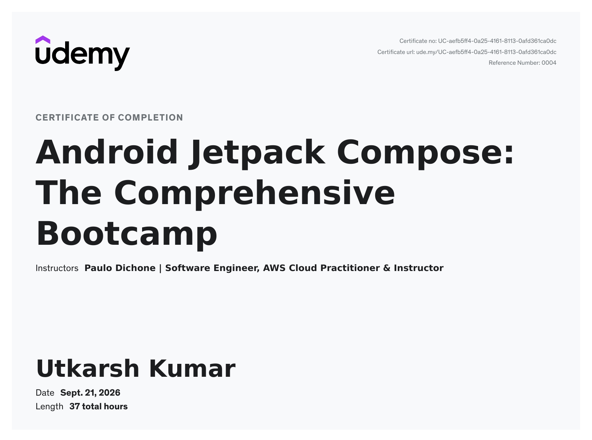

# Android Jetpack Compose Bootcamp 🎓

I'm continuously learning and improving my Android development skills with Kotlin and Jetpack Compose.

## Certificate of Completion

**Course:** Android Jetpack Compose: The Comprehensive Bootcamp  
**Platform:** Udemy  
**Instructor:** Paulo Dichone  
**Duration:** 37 hours  
**Completion Date:** September 21, 2026

### Certificate

### Learning Goals 🚀

- Strengthen my Kotlin programming skills.
- Build modern Android UIs using Jetpack Compose.
- Apply my learning through practical Android projects.
- Improve application architecture and code maintainability.

### Verify Certificate

View my certificate on Udemy= http://ude.my/UC-aefb5ff4-0a25-4161-8113-0afd361ca0dc

I'm looking forward to applying these skills in real-world Android projects!
